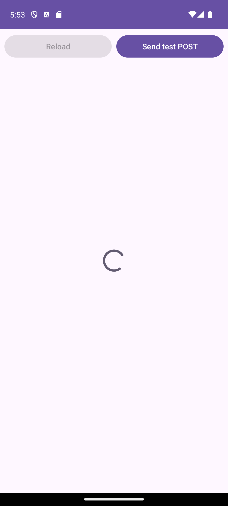
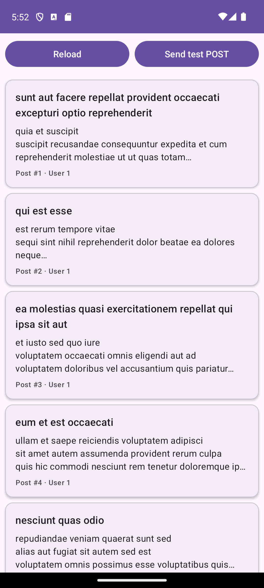
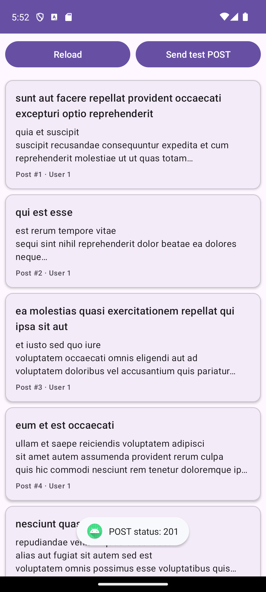
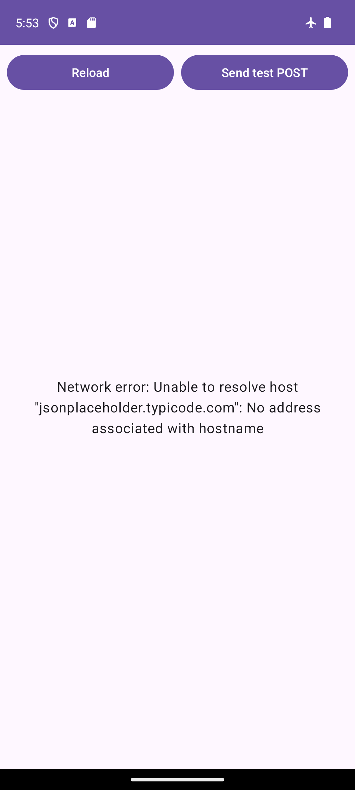
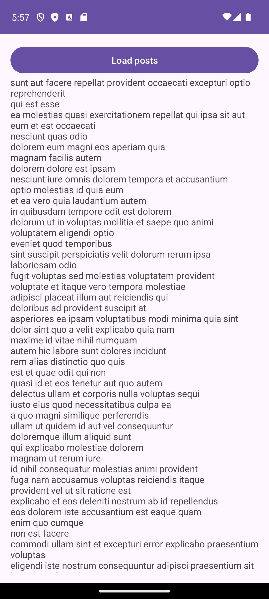

# Lab 8: HTTP Network Programming, JSON Parsing & Android Permissions

- Student: Võ Việt Tiến, ID 2474802010391 (individual lab)
- Course: Mobile Application Programming (71ITSE30603 / 72ITSE30603), Week 08, Session 15
- API used: https://jsonplaceholder.typicode.com/posts (100 posts, JSON array)

## What is in this repo

```
NewsReader/     main lab app (Steps 1 to 5), package com.vlu.newsreader
BuggyReader/    debugging challenge (2.3), package com.vlu.buggyreader
docs/           screenshots + logcat output for the NewsReader checkpoints
docs/Lab8_Debugging_Report_2474802010391.pdf   one page debugging report
```

Each folder is its own Android Studio project, open `NewsReader/` or `BuggyReader/` directly (File > Open).

NewsReader structure (same as the handout):

```
com.vlu.newsreader
├── MainActivity.kt          ViewBinding, loading / content / error states, Reload + Send test POST
├── model/NewsItem.kt        data class with @SerializedName
├── network/ApiConfig.kt     NEWS_URL (https only)
├── network/HttpClient.kt    HttpURLConnection, GET / POST / PUT / DELETE, blocking
├── parser/NewsJsonParser.kt parseManual (JSONArray / JSONObject) and parseWithGson
└── ui/NewsAdapter.kt        ListAdapter + DiffUtil, binds item_news.xml
```

## How it works (thread map)

`loadNews()`: `lifecycleScope.launch` (Main) → `withContext(Dispatchers.IO)` runs the HTTP GET →
`withContext(Dispatchers.Default)` parses the JSON → back on Main, `showContent()` calls `adapter.submitList()`.

Views are only touched on the Main thread, `HttpClient` never touches the UI and never picks a thread itself.

- `AndroidManifest.xml` has `android.permission.INTERNET` as a direct child of `<manifest>`.
- There is no `usesCleartextTraffic`, every URL is `https://`.
- Errors: `IOException` (no network, airplane mode, timeout) shows "Network error: ...", a non 2xx code shows
  "Server returned HTTP x", a `JSONException` shows "Data format error: ...". The app does not crash in any of these.

## Checkpoints

Tested on a Pixel 7 emulator (Android 14, API 34).

1. Gradle sync and `assembleDebug` pass.
2. `NewsItem` compiles, keys match the JSON (`id`, `userId`, `title`, `body`).
3. Logcat shows `status=200 length=27520` ([log](docs/logcat/checkpoint3_http_get.txt)).
4. Logcat shows `manual=100 gson=100 equal=true` and the first `NewsItem` ([log](docs/logcat/checkpoint4_parsing.txt)).
5. 100 cards in the RecyclerView, Send test POST gives `POST status: 201` (server returns `"id": 101`,
   [log](docs/logcat/checkpoint5_post_201.txt)), airplane mode shows the error text and the app keeps running.

| Loading | Success (100 posts) | Send test POST | Airplane mode |
|---|---|---|---|
|  |  |  |  |

Small thing I noticed in airplane mode: Logcat only prints `E/NewsReader: Network failure` without a stack trace.
That is because `android.util.Log` hides the stack trace when the cause is an `UnknownHostException`
(no DNS = no network), it is not a bug in the app.

Unit tests: `NewsReader/app/src/test/.../NewsJsonParserTest.kt` (6 tests) check that the manual parser and Gson give
the same list, that missing optional keys get default values, and that a missing `id` or a `{` root throws `JSONException`.
Run with `gradlew testDebugUnitTest`.

## Debugging challenge (BuggyReader)

The commits follow the task order, so the history shows the bug and each fix:

1. `chore: add BuggyReader exactly as committed...` the code from the handout, crashes on Load posts.
2. `fix(buggyreader): move the HTTP call and parsing to Dispatchers.IO` fixes `android.os.NetworkOnMainThreadException`.
3. `fix(buggyreader): declare INTERNET permission` fixes `java.lang.SecurityException: Permission denied (missing INTERNET permission?)`.

Full stack traces are in [BuggyReader/docs/logcat](BuggyReader/docs/logcat), the analysis is in the
[debugging report](docs/Lab8_Debugging_Report_2474802010391.pdf). After both fixes the app shows all 100 titles:



## Differences from the handout

- Android Studio here uses AGP 9.4.1, which has Kotlin built in. Because of that, `id("org.jetbrains.kotlin.android")` and
  `kotlinOptions { jvmTarget = "17" }` are removed (AGP 9 does not accept them with built-in Kotlin on), and the Kotlin JVM target follows `compileOptions` (Java 17).
  Library versions are the same as the handout (Gson 2.11.0, coroutines 1.9.0, lifecycle 2.8.7, ...).
- `compileSdk = 35` instead of 34, because core-ktx 1.15.0 needs compileSdk 35. `minSdk = 24` and `targetSdk = 34` stay the same.
- If Send test POST fails it shows a Toast instead of the error text, so a failed POST does not clear a list that is already loaded.
- Reload is disabled while a request is running, so tapping it many times does not send many requests.
- `org.json:json` is added as `testImplementation` only, because `android.jar` has only stubs of `org.json` for JVM unit tests.

## How to run

1. Open `NewsReader/` in Android Studio, let Gradle sync, run on an emulator or phone with Internet.
2. Same for `BuggyReader/` (current version has both fixes; check out commit `ef641c7` to see the original crash).
